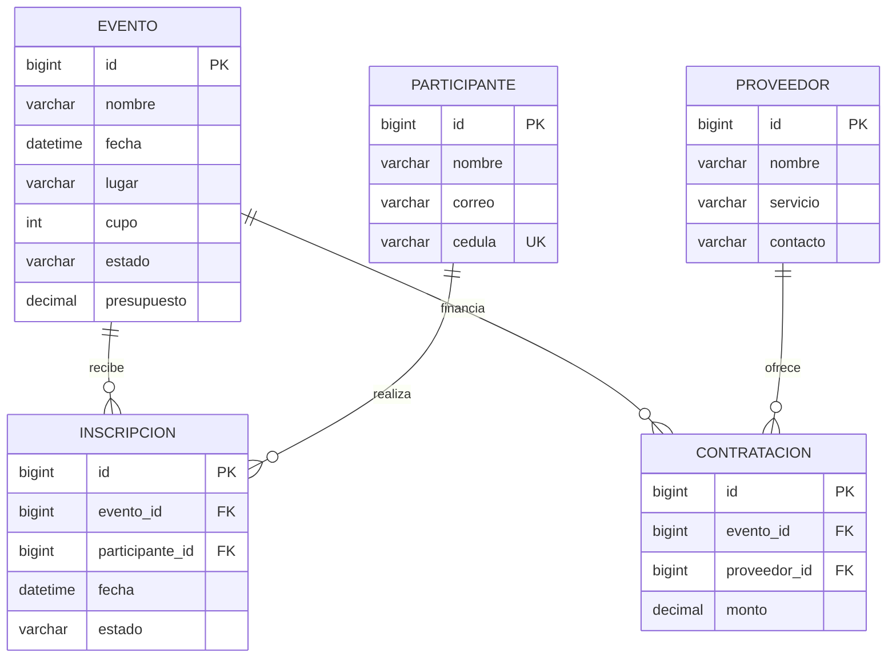

# Documento técnico - Gestión de eventos

## 1. Problema, usuarios y proceso

Una organización que celebra ferias, congresos o actividades culturales necesita coordinar participantes y proveedores sin superar el aforo ni el presupuesto aprobado. La información dispersa dificulta detectar duplicados, eventos cerrados y compromisos de gasto mayores al dinero disponible.

El sistema crea un evento con fecha, lugar, cupo y presupuesto; registra personas; inscribe participantes mientras el evento está abierto; contrata servicios; y calcula gasto y saldo. Las decisiones automáticas son impedir sobrecupo, rechazar duplicados, negar inscripciones a eventos cerrados y rechazar contrataciones sin saldo.

La API está dirigida a administradores, organizadores y usuarios de consulta. Los cinco módulos comparten este proceso; Cada app contiene sus propias vistas funcionales, permisos, paginación y administración, siguiendo GameArena.

## 2. Relación con el ejemplo de clase

Referencia consultada: [Irwin92/respositorio_gameArena_g2](https://github.com/Irwin92/respositorio_gameArena_g2), rama `main`, el 26 de octubre de 2026. Se consultaron `gamearena_backend/settings.py`, `gamearena_backend/urls.py`, `torneos/models.py`, `torneos/serializers.py`, `torneos/views.py`, `videojuegos/views.py`, `videojuegos/serializers.py` y `jugadores/models.py`.

Se mantienen las vistas funcionales `@api_view`, `ModelSerializer`, rutas incluidas por app, `Response`, autenticación TokenAuthentication, MySQL, consultas ORM y el formato de paginación del ejemplo. El dominio de videojuegos/torneos/jugadores se sustituye por eventos/participantes y se añaden proveedores y presupuesto. Se completan permisos de tres perfiles, protección de PATCH, transacciones y documentación. No se reutilizan credenciales ni la base de datos del ejemplo.

## 3. Módulos: entradas, salidas y relaciones

| App | Entradas principales | Salidas | Relaciones |
|---|---|---|---|
| eventos | nombre, fecha, lugar, cupo, estado, presupuesto | evento, inscritos activos, gasto, saldo | 1:N con inscripciones y contrataciones; N:M con proveedores |
| participantes | nombre, correo, cédula | identidad validada | 1:N con inscripciones |
| inscripciones | evento, participante, estado | inscripción y fecha automática | Une evento y participante |
| proveedores | nombre, servicio, contacto | proveedor disponible para contratar | N:M con eventos mediante contrataciones |
| presupuesto | evento, proveedor, monto | contratación; gasto acumulado y saldo por evento | Tabla intermedia de la N:M con atributo monto |

## 4. Modelo relacional



La relación N:M solicitada es EVENTO-PROVEEDOR: `Evento.proveedores` usa `through='presupuesto.Contratacion'`. Cada proveedor puede participar en muchos eventos y cada evento contratar muchos proveedores. El monto pertenece al vínculo. Inscripción también representa un vínculo entre personas y eventos.

Restricciones de BD: cédula única; par evento-participante único (incluso si la inscripción está cancelada); par evento-proveedor único; cupo > 0; presupuesto >= 0; monto > 0; estados válidos mediante CHECK. El correo debe ser válido pero no es único, porque el alcance de las imágenes solo exige cédula única.

Todas las FK de negocio usan `PROTECT`: evitan borrar accidentalmente historial o compromisos de gasto. La API devuelve 409 en esos conflictos. Para eliminar un padre con relaciones, primero se deben borrar explícitamente sus inscripciones/contrataciones. Una inscripción cancelada libera aforo, pero sigue siendo historial y conserva la restricción única; se reactiva con PATCH sobre el mismo registro.

## 5. Reglas de negocio y casos negativos

| Regla | Validación | Respuesta | Prueba principal |
|---|---|---|---|
| RN-01 | No inscribir ni reactivar si no hay cupo | 400 | `test_no_inscribir_evento_lleno`, `test_reactivacion_patch_respeta_cupo` |
| RN-02 | Una inscripción por participante y evento | 400; 409 si una carrera alcanza la restricción BD | `test_no_duplicar_inscripcion`, `test_restriccion_unica_en_bd` |
| RN-03 | Solo eventos ABIERTO y futuros admiten activación | 400 | `test_no_inscribir_evento_cerrado`, `test_evento_pasado_no_admite_inscripciones` |
| RN-04 | No crear ni cambiar fecha a una pasada | 400 | `test_fecha_pasada_creacion`, `test_fecha_pasada_patch` |
| RN-05 | Cupo entero mayor que cero | 400 | `test_cupo_positivo` |
| RN-06 | Total contratado no supera presupuesto | 400 con saldo disponible | `test_no_contratar_sobre_presupuesto`, `test_patch_contratacion_cuenta_otros_contratos` |
| RN-07 | No reducir cupo por debajo de inscritos activos en PUT/PATCH | 400 | `test_no_reducir_cupo_patch`, `test_no_reducir_cupo_put` |
| RN-08 | No borrar evento con inscripciones activas | 409 | `test_no_borrar_evento_con_inscripciones_activas` |
| RN-09 | Presupuesto no negativo ni inferior al gasto existente | 400 | `test_presupuesto_no_negativo`, `test_presupuesto_no_menor_gasto_patch_y_put` |
| RN-10 | Monto estrictamente positivo con dos decimales | 400 | `test_monto_positivo` |
| RN-11 | Proveedor no se contrata dos veces en el mismo evento | 400 | `test_contrato_no_duplicado` |
| RN-12 | No contratar para evento cancelado o finalizado | 400 | `test_no_contratar_evento_cerrado` |
| RN-13 | Identidad única por cédula y correo con formato válido | 400 | `test_cedula_unica`, `test_correo_invalido` |
| RN-14 | Las FK que identifican una inscripción/contratación son inmutables | 400 | `test_fks_inscripcion_inmutables`, `test_fks_contratacion_inmutables` |

La fecha existente de un evento que ya ocurrió puede conservarse al modificar otros campos; no se fuerza a falsificar una fecha futura para marcarlo finalizado. No se permite una inscripción activa en él. Cancelar inscripciones sigue permitido cuando el evento finaliza o se cancela.

Las imágenes mencionan tanto alertar por exceso como prohibir el gasto: se aplica la prohibición explícita de RN-06 y la alerta se transmite como error 400 con el saldo. Alcanzar exactamente el presupuesto sí se permite.

## 6. Seguridad y matriz de permisos

Se usan usuarios y grupos estándar de Django y tokens de `rest_framework.authtoken`, como en el repo. La API exige `Authorization: Token <clave>`. No acepta autenticación de sesión en endpoints REST, evitando diferencias de 401/403 entre mecanismos. El admin de Django conserva sesión y CSRF.

| Recurso / operación | Administrador | Organizador | Consulta |
|---|---|---|---|
| GET eventos y subconsultas | Sí | Sí | Sí |
| POST/PUT/PATCH/DELETE eventos | Sí | Sí | No |
| GET participantes | Sí | Sí | Sí |
| POST/PUT/PATCH/DELETE participantes | Sí | No | No |
| GET inscripciones | Sí | Sí | Sí |
| POST/PUT/PATCH/DELETE inscripciones | Sí | No | No |
| GET proveedores | Sí | Sí | Sí |
| POST/PUT/PATCH/DELETE proveedores | Sí | Sí | No |
| GET contrataciones / balance | Sí | Sí | Sí |
| POST/PUT/PATCH/DELETE contrataciones | Sí | Sí | No |
| GET reportes y perfil | Sí | Sí | Sí |
| POST token | Credenciales válidas | Credenciales válidas | Credenciales válidas |
| POST logout | Token válido | Token válido | Token válido |

Grupo `Administrador`, `is_staff` o `is_superuser` concede administración. Un usuario autenticado sin ninguno de los tres roles obtiene 403 en recursos de negocio. Sin token, con token inválido o con usuario inactivo obtiene 401. Un usuario puede recibir varios grupos; se suman sus permisos. No existe endpoint público para cambiar roles.

El login limita solicitudes anónimas a 20 por minuto y dirección IP en la caché local del proceso. En un despliegue con varios procesos se debe configurar una caché compartida. Los tokens no expiran automáticamente y logout revoca el token único del usuario.

## 7. Catálogo final de endpoints

Base local: `http://127.0.0.1:8000`. Todos devuelven JSON; DELETE exitoso devuelve 204 sin cuerpo.

| Ruta | Métodos | Resultado |
|---|---|---|
| `/api/token/` | POST | 200 token; 400 credenciales inválidas; 429 límite |
| `/api/me/` | GET | 200 identidad y roles |
| `/api/logout/` | POST | 204 token revocado |
| `/api/eventos/` | GET, POST | 200 listado; 201 creado |
| `/api/eventos/{id}/` | GET, PUT, PATCH, DELETE | 200 lectura/edición; 204 borrado; 409 relaciones |
| `/api/eventos/{id}/inscripciones/` | GET | 200 listado paginado |
| `/api/eventos/{id}/presupuesto/` | GET | 200 presupuesto, gasto, saldo y contratos |
| `/api/participantes/` | GET, POST | 200 listado; 201 creado |
| `/api/participantes/{id}/` | GET, PUT, PATCH, DELETE | 200 lectura/edición; 204 borrado; 409 relaciones |
| `/api/inscripciones/` | GET, POST | 200 listado; 201 creada |
| `/api/inscripciones/{id}/` | GET, PUT, PATCH, DELETE | 200 lectura/edición; 204 borrado |
| `/api/proveedores/` | GET, POST | 200 listado; 201 creado |
| `/api/proveedores/{id}/` | GET, PUT, PATCH, DELETE | 200 lectura/edición; 204 borrado; 409 relaciones |
| `/api/presupuesto/` | GET, POST | 200 contrataciones; 201 creada |
| `/api/presupuesto/{id}/` | GET, PUT, PATCH, DELETE | 200 lectura/edición; 204 borrado |
| `/api/reportes/resumen/` | GET | 200 agregaciones y eventos con cupo |

Todas las rutas protegidas pueden responder 401/403. Los detalles inexistentes devuelven 404. Las operaciones de escritura pueden responder 400 por validación y 409 por restricciones de integridad concurrentes. Un método no soportado devuelve 405. Los errores de parámetros se traducen a 400, sin convertir valores inválidos directamente en excepciones del ORM.

### Cuerpos JSON de creación

```json
{
  "nombre": "Feria de emprendimientos",
  "fecha": "2026-12-10T09:00:00-06:00",
  "lugar": "Puntarenas",
  "cupo": 50,
  "estado": "ABIERTO",
  "presupuesto": "500000.00"
}
```

```json
{"nombre": "Ana Solís", "correo": "ana@example.com", "cedula": "DEMO-001"}
```

```json
{"evento": 1, "participante": 1, "estado": "ACTIVA"}
```

```json
{"nombre": "Sonido Pacífico", "servicio": "Audio", "contacto": "demo@example.com"}
```

```json
{"evento": 1, "proveedor": 1, "monto": "100000.00"}
```

Los IDs anteriores son ilustrativos; use los que devuelvan sus POST. `id`, fecha automática de inscripción, nombres relacionados y campos calculados son de solo lectura. `estado` por defecto es ABIERTO en eventos y ACTIVA en inscripciones. PUT exige todos los campos obligatorios; PATCH combina los enviados con los valores existentes antes de validar.

### Filtros y paginación

| Recurso | Filtros combinables | Búsqueda | Ordenamiento |
|---|---|---|---|
| eventos | estado, lugar, fecha_desde, fecha_hasta, proveedor | search: nombre/lugar | nombre, fecha, presupuesto, cupo |
| participantes | cedula, correo, evento | search: nombre/correo/cédula | nombre fijo |
| proveedores | servicio, evento | search: nombre/servicio/contacto | nombre fijo |
| inscripciones | evento, participante, estado | No | PK estable |
| presupuesto | evento, proveedor | No | PK estable |

Fechas de filtro: `YYYY-MM-DD`, según America/Costa_Rica. `ordering=-campo` invierte el orden. Todas las listas usan `page` y cinco registros por página. Se emplea `Paginator.get_page`, como en GameArena: una página no numérica usa la primera y una página fuera de rango usa la última, con HTTP 200. No se admite personalizar el tamaño mediante `page_size`. Los filtros inválidos devuelven 400.

```json
{"pagina_actual": 1, "total_paginas": 1, "total_registros": 0, "resultados": []}
```

Errores de validación:

```json
{"detail": "Revise los datos enviados.", "errores": {"cupo": ["No puede ser menor que las inscripciones activas."]}}
```

Conflicto:

```json
{"detail": "No se puede borrar un evento con inscripciones activas."}
```

## 8. Consultas ORM no triviales

1. `eventos/views.py`: `Count('inscripciones', filter=Q(...), distinct=True)` calcula inscritos activos por evento.
2. `eventos/views.py`: `Subquery` con `OuterRef`, `Sum('monto')` y `Coalesce` calcula gasto por evento sin multiplicarlo al combinar dos relaciones 1:N.
3. `eventos/views.py`: `values('estado').annotate(total=Count('pk'))` agrupa eventos por estado.
4. `eventos/views.py`: filtro `_inscritos_activos__lt=F('cupo')` obtiene eventos abiertos con cupo.
5. `eventos/views.py`: orden por `-_inscritos_activos` obtiene el evento de mayor participación; `aggregate` calcula presupuesto y gasto global.
6. `participantes/views.py`: filtra personas por `inscripciones__evento_id` y correo, con `distinct()`.
7. `proveedores/views.py`: filtra proveedores por contratación de un evento y servicio.
8. `inscripciones/views.py` y `presupuesto/views.py`: `select_related('evento', 'participante'/'proveedor')` evita N+1 al serializar nombres.

El listado de eventos tiene una prueba de número acotado de consultas y una prueba con dos inscripciones y dos contratos que verifica que no se multipliquen los montos.

## 9. Transacciones, concurrencia y alcance de integridad

MySQL utiliza InnoDB y Django emplea READ COMMITTED por defecto. Las escrituras relacionadas bloquean primero la fila del evento con `select_for_update()` y después la inscripción/contratación, si existe. Se vuelve a validar dentro del bloqueo y se guarda dentro de `transaction.atomic()`.

La edición/borrado del evento utiliza el mismo bloqueo. Dos inscripciones que compiten por el último cupo o dos contratos que compiten por el saldo se serializan sobre el mismo evento. Se incluyen pruebas simultáneas con dos conexiones en `tests/test_concurrencia.py`; solo se ejecutan con MySQL. SQLite no implementa este bloqueo y por eso esas dos pruebas se omiten expresamente allí.

Las restricciones de una fila y unicidad se protegen también en BD. Las reglas agregadas entre tablas dependen del camino de escritura de la API; no se garantiza que scripts externos que escriban directamente por ORM respeten estas reglas. El admin de negocio es de solo lectura para evitar otro camino de escritura sin validaciones.

## 10. Trazabilidad de requisitos

| Requisito | Evidencia implementada |
|---|---|
| RF-01 Cinco módulos | Cinco apps y sección 3 |
| RF-02 CRUD | CRUD completo en las cinco apps, `CRUDTests` |
| RF-03 Relaciones | ER, FK PROTECT, N:M through, restricciones y migraciones |
| RF-04 Cinco consultas ORM | Sección 8 y `ConsultasTests` |
| RF-05 Consulta REST | Filtros combinables en cinco recursos; búsqueda en tres; orden configurable en eventos; paginación en todos |
| RF-06 Ocho reglas y PATCH | Catorce reglas; `ReglasTests` |
| RF-07 Tres perfiles | Matriz, permisos y `SeguridadTests` |
| RF-08 HTTP | 200/201/204/400/401/403/404/409 y pruebas |
| RF-09 Calidad | README, dependencias fijadas, migraciones, Postman y pruebas |

La asignación menciona 13 pruebas en una sección y al menos 15 en evidencias. Se cubre el mínimo más exigente con 66 casos, de los cuales dos requieren MySQL. El historial de colaboración y la defensa individual corresponden a trabajo real del equipo, no se presentan como evidencias generadas por este código.
