# Documentación del frontend

## 1. Matriz de pantallas y endpoints

Relaciona cada acción de la interfaz con la solicitud HTTP que envía a la API. Todas las rutas de la API tienen como base `VITE_API_URL` (por defecto `/api`, redirigido por el proxy de Vite a `http://127.0.0.1:8000/api`).

**Perfiles:** A = Administrador · O = Organizador · C = Consulta. Todas las solicitudes, excepto el login, envían `Authorization: Token <token>`. Sin token válido la API responde **401** y el frontend cierra la sesión.

### 1.1 Acceso

| Pantalla (ruta) | Acción en la interfaz | Método | Endpoint | Perfiles | Respuesta correcta | Errores manejados |
|---|---|---|---|---|---|---|
| Login (`/login`) | Iniciar sesión | POST | `/api/token/` | Todos | 200 `{ token }` | 400 credenciales incorrectas, error de red |
| Menú (todas) | Cerrar sesión (revoca el token) | POST | `/api/logout/` | A, O, C | 204 | Error de red (igual limpia la sesión local) |

### 1.2 Resumen (dashboard)

| Pantalla (ruta) | Acción en la interfaz | Método | Endpoint | Perfiles | Respuesta correcta | Errores manejados |
|---|---|---|---|---|---|---|
| Resumen (`/`) | Cargar indicadores | GET | `/api/reportes/resumen/` | A, O, C | 200 | 401, 403, red |

### 1.3 Eventos

| Pantalla (ruta) | Acción en la interfaz | Método | Endpoint | Perfiles | Respuesta correcta | Errores manejados |
|---|---|---|---|---|---|---|
| Eventos (`/eventos`) | Listar con paginación | GET | `/api/eventos/?page=` | A, O, C | 200 | 401, 403, red |
| Eventos | Filtrar por estado | GET | `/api/eventos/?estado=` | A, O, C | 200 | 400 estado desconocido |
| Eventos | Buscar por nombre o lugar | GET | `/api/eventos/?search=` | A, O, C | 200 | — |
| Eventos | Ordenar (fecha, nombre, presupuesto, cupo) | GET | `/api/eventos/?ordering=` | A, O, C | 200 | 400 orden no permitido |
| Eventos | Crear evento | POST | `/api/eventos/` | A, O | 201 | 400 validación (fecha pasada, cupo ≤ 0), 403 |
| Eventos | Editar evento (formulario precargado) | PATCH | `/api/eventos/{id}/` | A, O | 200 | 400 (cupo menor que inscritos, presupuesto menor que gasto), 403, 404 |
| Eventos | Eliminar evento (con confirmación) | DELETE | `/api/eventos/{id}/` | A, O | 204 | 409 tiene inscripciones o contrataciones, 403, 404 |
| Eventos → panel Inscripciones | Ver inscritos del evento | GET | `/api/eventos/{id}/inscripciones/?page=` | A, O, C | 200 | 401, 403 |
| Eventos → panel Inscripciones | Cargar participantes del selector | GET | `/api/participantes/?page=` | A, O, C | 200 | 401, 403 |
| Eventos → panel Inscripciones | Inscribir participante | POST | `/api/inscripciones/` | A | 201 | 400 (cupo lleno, duplicado, evento no abierto), 403 |
| Eventos → panel Presupuesto | Ver balance del evento | GET | `/api/eventos/{id}/presupuesto/` | A, O, C | 200 | 401, 403 |
| Eventos → panel Presupuesto | Cargar proveedores del selector | GET | `/api/proveedores/?page=` | A, O, C | 200 | 401, 403 |
| Eventos → panel Presupuesto | Contratar proveedor | POST | `/api/presupuesto/` | A, O | 201 | 400 (presupuesto excedido, duplicado, evento cancelado/finalizado), 403 |
| Eventos → panel Presupuesto | Quitar contratación | DELETE | `/api/presupuesto/{id}/` | A, O | 204 | 403, 404 |

### 1.4 Participantes

| Pantalla (ruta) | Acción en la interfaz | Método | Endpoint | Perfiles | Respuesta correcta | Errores manejados |
|---|---|---|---|---|---|---|
| Participantes (`/participantes`) | Listar con paginación | GET | `/api/participantes/?page=` | A, O, C | 200 | 401, 403, red |
| Participantes | Crear participante | POST | `/api/participantes/` | A | 201 | 400 (cédula repetida, correo inválido, campos vacíos), 403 |
| Participantes | Editar participante (formulario precargado) | PATCH | `/api/participantes/{id}/` | A | 200 | 400, 403, 404 |
| Participantes | Eliminar participante (con confirmación) | DELETE | `/api/participantes/{id}/` | A | 204 | 409 tiene inscripciones, 403, 404 |

### 1.5 Inscripciones

| Pantalla (ruta) | Acción en la interfaz | Método | Endpoint | Perfiles | Respuesta correcta | Errores manejados |
|---|---|---|---|---|---|---|
| Inscripciones (`/inscripciones`) | Cargar eventos y participantes de los selectores | GET | `/api/eventos/?page=` y `/api/participantes/?page=` | A, O, C | 200 | 401, 403, red |
| Inscripciones | Listar con paginación | GET | `/api/inscripciones/?page=` | A, O, C | 200 | 401, 403, red |
| Inscripciones | Filtros combinables (estado + evento + participante) | GET | `/api/inscripciones/?estado=&evento=&participante=` | A, O, C | 200 | 400 parámetro inválido |
| Inscripciones | Inscribir participante | POST | `/api/inscripciones/` | A | 201 | 400 (cupo lleno, duplicado, evento no abierto o pasado), 403 |
| Inscripciones | Cancelar o reactivar | PATCH | `/api/inscripciones/{id}/` `{ estado }` | A | 200 | 400 (al reactivar: cupo lleno, evento no abierto), 403, 404 |
| Inscripciones | Eliminar inscripción (con confirmación) | DELETE | `/api/inscripciones/{id}/` | A | 204 | 403, 404 |

### 1.6 Proveedores

| Pantalla (ruta) | Acción en la interfaz | Método | Endpoint | Perfiles | Respuesta correcta | Errores manejados |
|---|---|---|---|---|---|---|
| Proveedores (`/proveedores`) | Listar con paginación | GET | `/api/proveedores/?page=` | A, O, C | 200 | 401, 403, red |
| Proveedores | Crear proveedor | POST | `/api/proveedores/` | A, O | 201 | 400 validación, 403 |
| Proveedores | Editar proveedor (formulario precargado) | PATCH | `/api/proveedores/{id}/` | A, O | 200 | 400, 403, 404 |
| Proveedores | Eliminar proveedor (con confirmación) | DELETE | `/api/proveedores/{id}/` | A, O | 204 | 409 tiene contrataciones, 403, 404 |

### 1.7 Presupuesto (contrataciones)

| Pantalla (ruta) | Acción en la interfaz | Método | Endpoint | Perfiles | Respuesta correcta | Errores manejados |
|---|---|---|---|---|---|---|
| Presupuesto (`/presupuesto`) | Cargar eventos y proveedores de los selectores | GET | `/api/eventos/?page=` y `/api/proveedores/?page=` | A, O, C | 200 | 401, 403, red |
| Presupuesto | Listar con paginación | GET | `/api/presupuesto/?page=` | A, O, C | 200 | 401, 403, red |
| Presupuesto | Filtros combinables (evento + proveedor) | GET | `/api/presupuesto/?evento=&proveedor=` | A, O, C | 200 | 400 parámetro inválido |
| Presupuesto | Contratar proveedor | POST | `/api/presupuesto/` | A, O | 201 | 400 (presupuesto excedido, duplicado, evento cancelado/finalizado), 403 |
| Presupuesto | Editar monto (formulario precargado) | PATCH | `/api/presupuesto/{id}/` `{ monto }` | A, O | 200 | 400 presupuesto excedido, 403, 404 |
| Presupuesto | Eliminar contratación (con confirmación) | DELETE | `/api/presupuesto/{id}/` | A, O | 204 | 403, 404 |

### 1.8 Cobertura de requisitos de consulta (RF2-08)

| Requisito | Dónde se cumple | Parámetros del backend |
|---|---|---|
| Filtros combinables en dos recursos | Inscripciones y Presupuesto | `estado`, `evento`, `participante` / `evento`, `proveedor` |
| Búsqueda en un recurso | Eventos | `search` |
| Ordenamiento en un recurso | Eventos | `ordering` |
| Paginación en al menos dos listados | Eventos, Participantes, Inscripciones, Proveedores y Presupuesto | `page` |

Los filtros, la búsqueda, el orden y la paginación se envían siempre al backend; el frontend no filtra los datos localmente.

## 2. Matriz de permisos y escenarios manuales

### 2.1 Permisos por perfil

Los aplica el backend en cada endpoint; el frontend solo muestra el mensaje que corresponde. Ocultar un botón no reemplaza la validación del servidor.

| Módulo | Administrador (`admin_demo`) | Organizador (`organizador_demo`) | Consulta (`consulta_demo`) |
|---|---|---|---|
| Resumen | Ver | Ver | Ver |
| Eventos | Ver, crear, editar, eliminar | Ver, crear, editar, eliminar | Solo ver |
| Participantes | Ver, crear, editar, eliminar | Solo ver | Solo ver |
| Inscripciones | Ver, inscribir, cancelar/reactivar, eliminar | Solo ver | Solo ver |
| Proveedores | Ver, crear, editar, eliminar | Ver, crear, editar, eliminar | Solo ver |
| Presupuesto | Ver, contratar, editar monto, eliminar | Ver, contratar, editar monto, eliminar | Solo ver |

| Situación | Respuesta de la API | Comportamiento del frontend |
|---|---|---|
| Sin token o token inválido/revocado | 401 | Cierra la sesión y redirige a `/login` con aviso |
| Perfil sin permiso para la operación | 403 | Muestra "Su perfil no tiene permiso para esta operación." |
| Ruta privada sin sesión | — | `RutaProtegida` redirige a `/login` sin llamar a la API |

### 2.2 Escenarios manuales

Ejecutados con el backend (`runserver`) y el frontend (`npm run dev`) en local, con los datos de `seed_demo`.

| # | Escenario | Perfil | Pasos | Resultado esperado | Resultado obtenido | Captura |
|---|---|---|---|---|---|---|
| 1 | Inicio de sesión correcto | Administrador | Abrir `/login`, ingresar usuario y contraseña válidos | Redirige a `/`, el menú muestra el usuario y carga el resumen | | `02-dashboard.png` |
| 2 | Inicio de sesión incorrecto | — | Ingresar una contraseña incorrecta | Mensaje de credenciales incorrectas; permanece en `/login` | | `01-login.png` |
| 3 | Ruta protegida sin sesión | — | Sin sesión, escribir `localhost:5173/eventos` en la barra de direcciones | Redirige a `/login` | | — |
| 4 | Navegación y persistencia de sesión | Administrador | Recorrer los 6 enlaces del menú y presionar F5 en uno de ellos | La URL cambia sin recargar la página; tras F5 la sesión continúa | | `03` a `07` |
| 5 | Crear registro | Administrador | En Eventos, completar el formulario con datos válidos y guardar | Mensaje de éxito; el evento aparece en la lista | | `08-formulario-crear.png` |
| 6 | Validación de datos | Administrador | Crear un evento con cupo 0 o fecha pasada | Mensaje de validación; no se guarda | | `10-error-validacion.png` |
| 7 | Editar con formulario precargado | Administrador | En Participantes, presionar Editar, cambiar el correo y guardar | El formulario se llena con los datos actuales; se guarda el cambio | | `09-formulario-editar.png` |
| 8 | Eliminar con confirmación y conflicto | Administrador | Eliminar un evento que tiene inscripciones activas | Pide confirmación; luego muestra el mensaje 409 y el evento no se borra | | — |
| 9 | Filtros combinables y paginación | Administrador | En Inscripciones, filtrar por estado y por evento a la vez; usar Anterior/Siguiente | Solo aparecen las coincidencias; la paginación avanza y retrocede | | `05-inscripciones.png` |
| 10 | Búsqueda y ordenamiento | Administrador | En Eventos, buscar una palabra del nombre y ordenar por presupuesto (mayor a menor) | Solo aparecen coincidencias, ordenadas por presupuesto | | `03-eventos.png` |
| 11 | Acceso denegado (403) | Consulta y Organizador | Con `consulta_demo`, crear un participante; con `organizador_demo`, inscribir a alguien | En ambos casos: "Su perfil no tiene permiso para esta operación." | | `11-error-403.png` |
| 12 | Cierre de sesión y token inválido (401) | Administrador | a) Cerrar sesión y volver a `/eventos`. b) Iniciar sesión, cambiar el token en `localStorage` por `abc` y presionar F5 | a) Redirige a `/login`. b) Redirige a `/login` con el aviso de sesión expirada | | `12-sesion-expirada.png` |

En **Resultado obtenido** se marca ✅ si coincide con lo esperado o ❌ con una nota si no.

## 3. Capturas

Guardadas en `docs/capturas/`.

### 3.1 Inicio de sesión
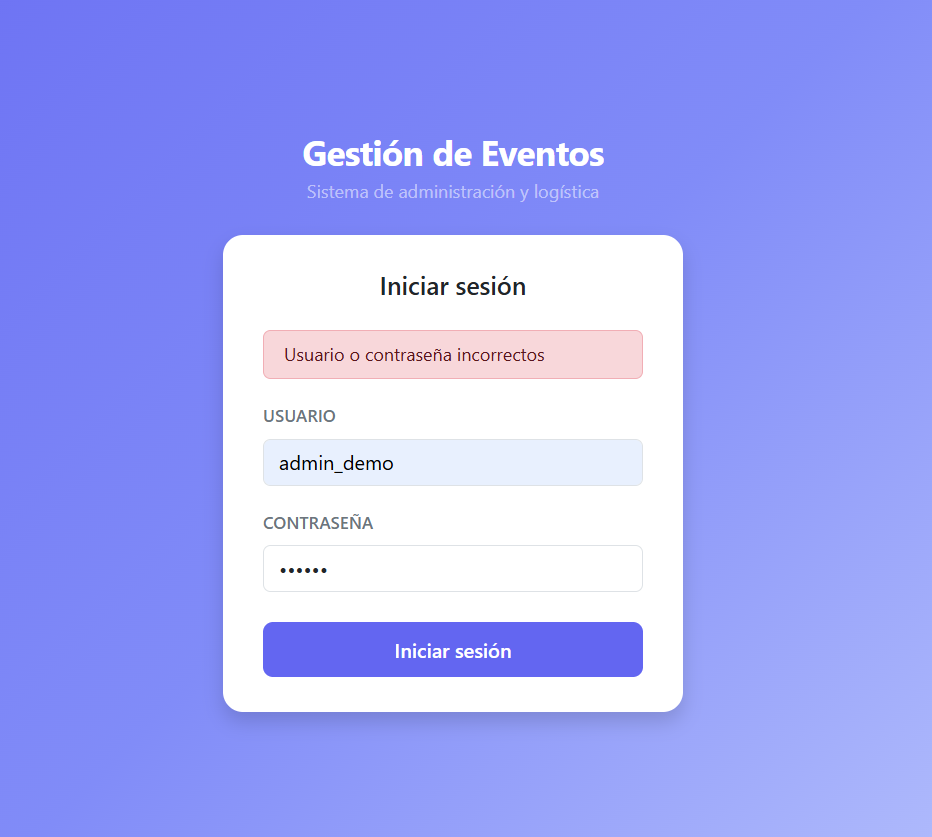

### 3.2 Dashboard
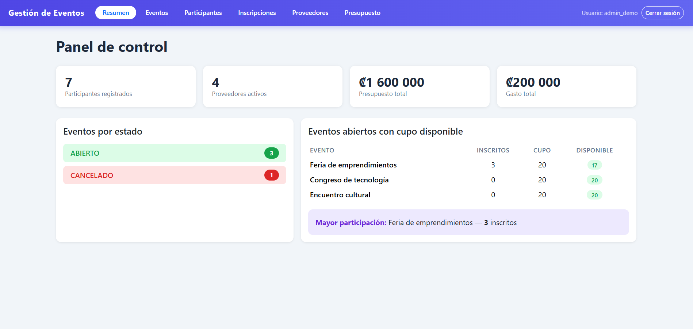

### 3.3 Módulos
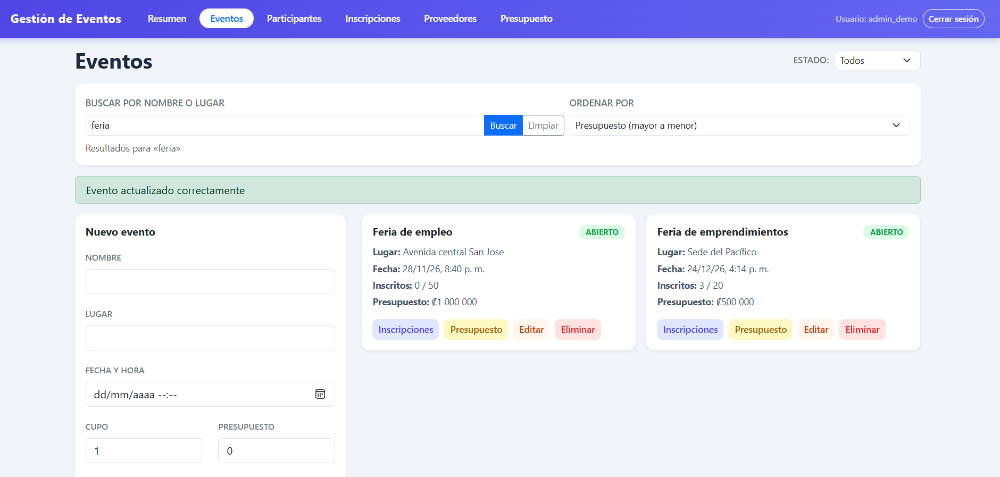
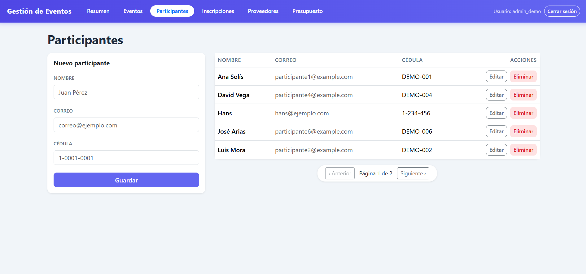
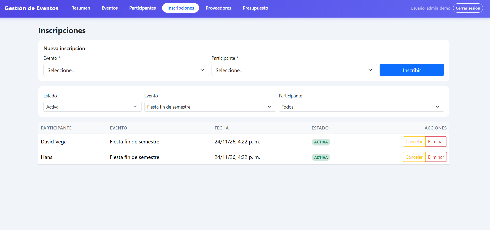
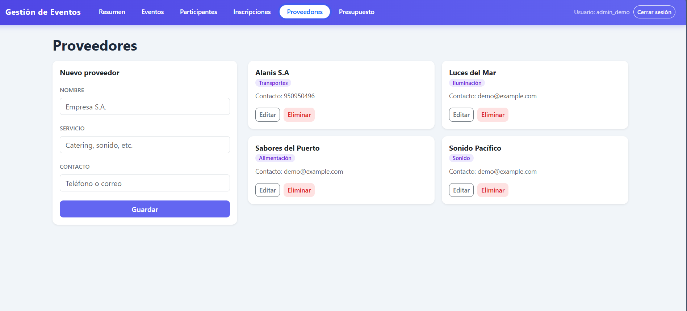
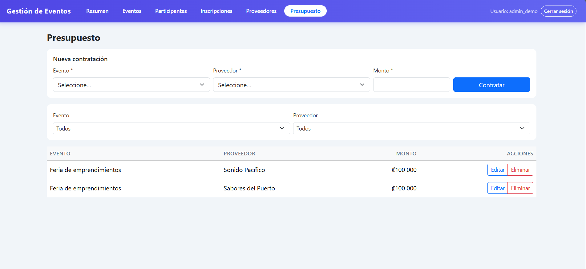

### 3.4 Formularios
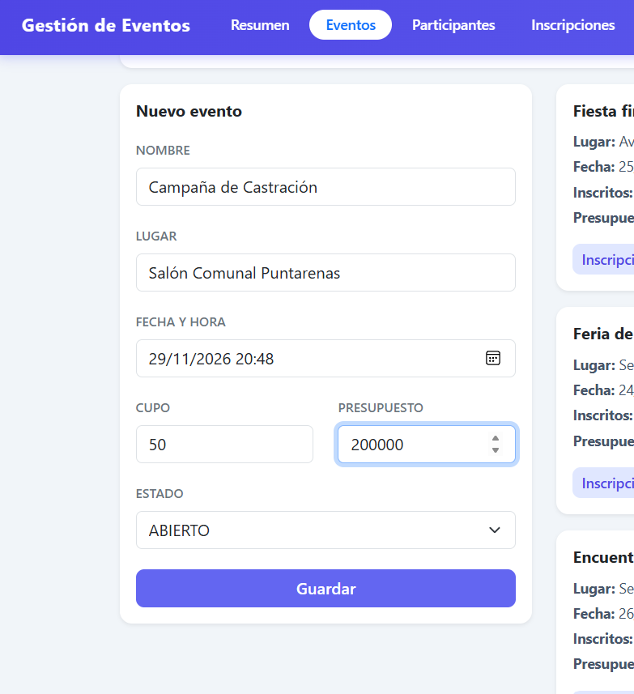
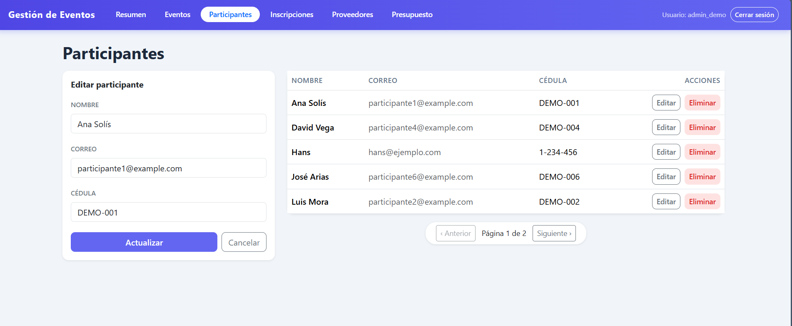

### 3.5 Errores
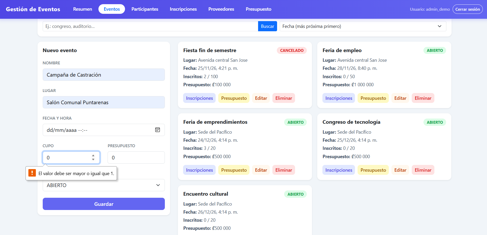
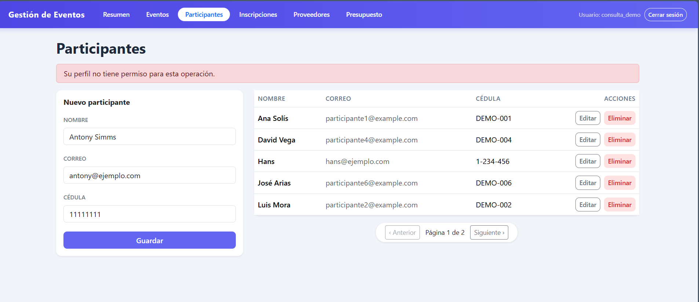
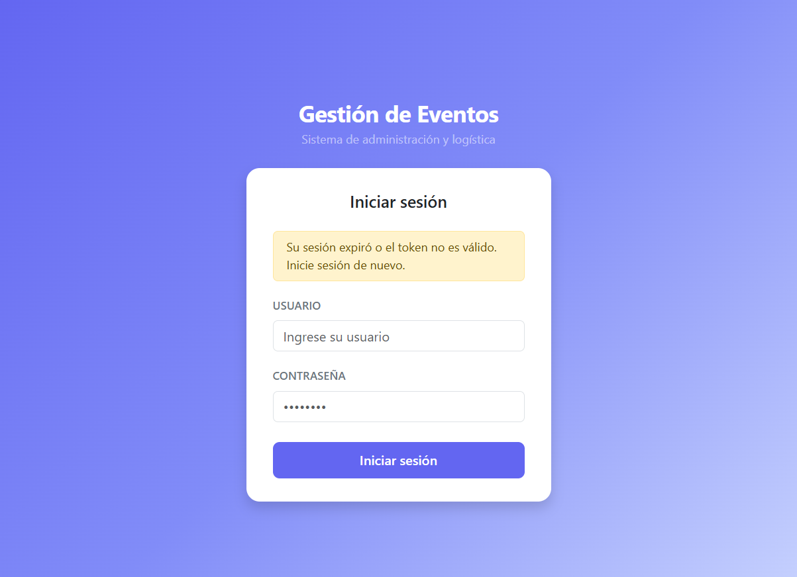

### 3.6 Vista en celular
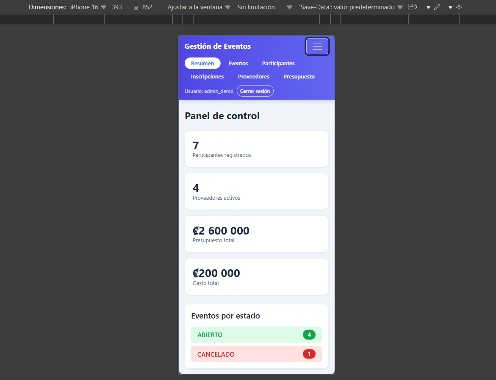
